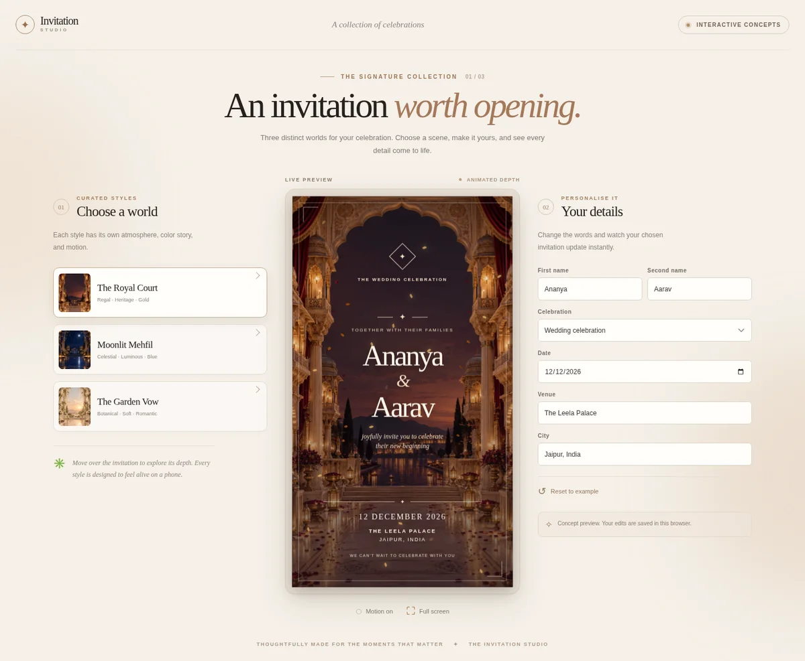
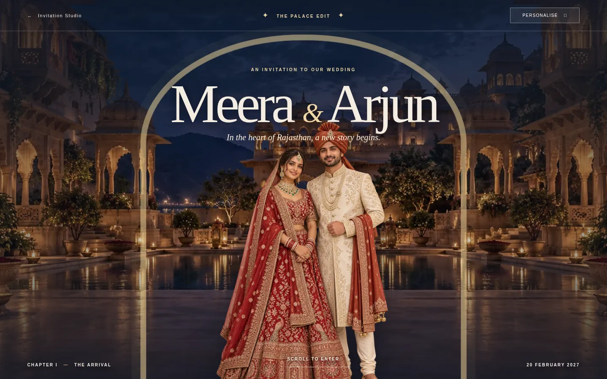

# Invitation Studio



An Indian wedding invitation prototype with three free style previews and one scrollable signature concept, **The Palace Edit**.

- **The Royal Court:** palace architecture, burgundy, and warm gold.
- **Moonlit Mehfil:** celestial blue courtyard and lantern light.
- **The Garden Vow:** botanical mandap, ivory, and blush florals.

The free scenes use original generated artwork, animated lighting and particles, and perspective-based depth. The names, occasion, date, venue, and city update live.

The [Palace Edit](https://vikasbanjare.github.io/weeding-invites/palace.html) is a palace-inspired, layered invitation with a fictional Indian couple portrait, five sample ceremonies, travel directions, editable event details, and downloadable keepsakes. Its editor supports up to eight ceremonies with event-specific date, time, place, description, and dress note. It respects reduced-motion preferences.



The gallery is hosted at <https://vikasbanjare.github.io/weeding-invites/>. The Palace Edit uses browser storage for local changes. **Copy invitation link** or **Share on WhatsApp** places the details in a public URL fragment, so anyone with that URL can read them. This is a prototype sharing mechanism, not a private account or production publishing system; social preview cards remain generic.

**Download motion invite** records the personalized artwork and ceremony programme in the browser. It uses MP4 if supported and otherwise WebM. The PNG card and `.ics` calendar are other download options. Checked in Chromium on 18 October 2026: a 540 × 960 H.264 MP4 with five events rendered successfully. Other browsers may choose WebM or lack recording support.

Run it locally with no install step:

```sh
cd /workspace/weeding-invites
python3 -m http.server 4173
```

Open the gallery at `http://localhost:4173/` and the premium concept at `http://localhost:4173/palace.html` from a browser on the same machine. The example names, dates, venue rooms, and illustrated people are fictional. There is no payment, guest RSVP backend, upload, private invitation hosting, or character animation yet.
